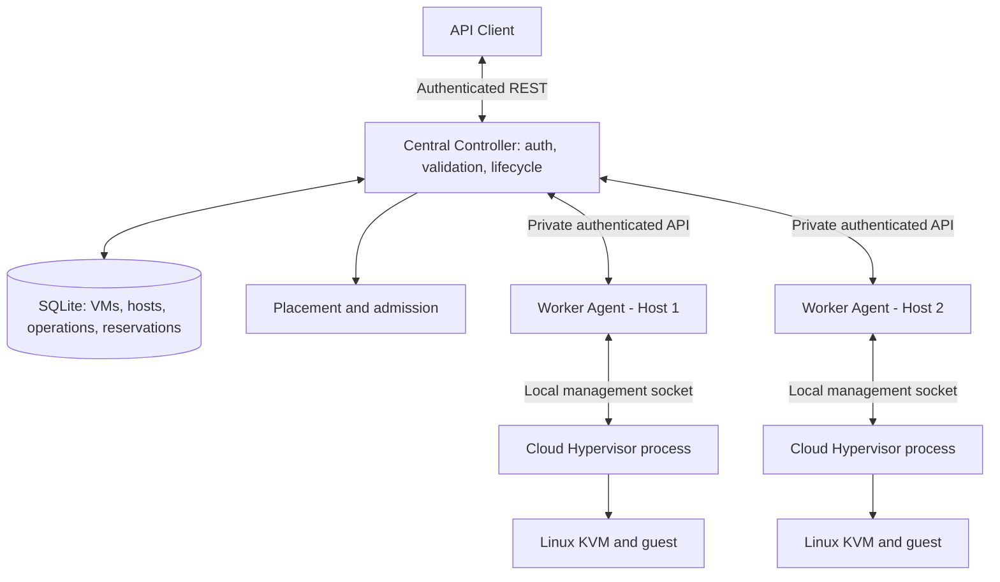
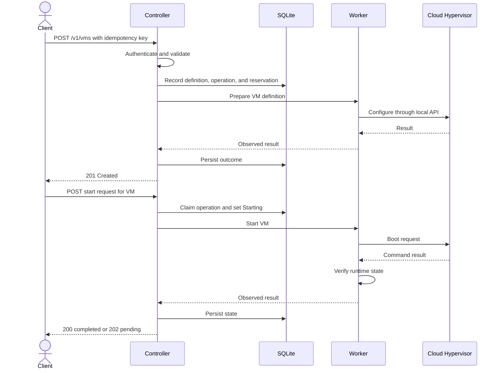

# 2. Architecture and API Design

## Candidate architectures

| Architecture | Strengths | Weaknesses | Fit |
|---|---|---|---|
| Synchronous controller + workers | Few components, fastest to implement | Long requests; timeouts create uncertainty; memory-only state fragile | Good MVP |
| Persistent controller + reconciliation | Restart recovery, durable operations/reservations | Requires transactions and reconciliation | **Recommended** |
| Asynchronous jobs + durable queue | Natural long-running operation tracking | More components, duplicate-job semantics, operational overhead | Excessive for two hosts unless required |

Recommended: synchronous HTTP calls initially, SQLite persistence, operation tracking, and reconciliation. Avoid a separate queue unless a concrete requirement justifies it.

## Architecture diagram



There are three interfaces: public controller API, private worker API, and the local Cloud Hypervisor management API. Do not expose privileged hypervisor management to clients.

## Component responsibilities

### Controller
- Client authentication, authorization, validation, and body limits.
- VM metadata and desired lifecycle state.
- Host eligibility, placement, and atomic reservations.
- Durable operation/idempotency records.
- Worker authentication and bounded calls.
- Lifecycle conflicts, error classification, and API responses.
- Restart recovery and reconciliation.

### Worker (same implementation on both hosts)
- Authenticate controller requests and enforce local policy.
- Report capacity and local inventory.
- Prepare VM-specific files and private management sockets.
- Start, inspect, shut down, supervise Cloud Hypervisor.
- Track process identity, wait/reap children, and clean owned resources.
- Report uncertainty rather than masking it.

### Cloud Hypervisor and KVM
Cloud Hypervisor configures/manages the guest and exposes its VMM API. KVM provides kernel virtualization. Local OS operations include file access, memory reporting, sockets, process supervision, and permissions. Global placement and durable intent belong to the controller.

## Lifecycle sequence



## Public REST API

| Method | Path | Purpose |
|---|---|---|
| GET | /v1/health | Minimal liveness |
| GET | /v1/hosts | Authorized host inventory/capacity |
| POST | /v1/vms | Create stopped definition |
| GET | /v1/vms | List VMs |
| GET | /v1/vms/{id} | VM details/runtime state |
| POST | /v1/vms/{id}/start | Start |
| POST | /v1/vms/{id}/stop | Stop |
| GET | /v1/operations/{id} | Inspect pending/uncertain operation |
| DELETE | /v1/vms/{id} | Optional deletion |

Health may be unauthenticated only if it exposes minimal information. Management and inventory endpoints require appropriate authorization.

Example request:

```json
{
  "name": "demo-vm",
  "image_id": "demo-linux-v1",
  "memory_mib": 1024,
  "vcpus": 2
}
```

Use an approved image ID, never an arbitrary host path. Example response:

```json
{
  "id": "vm-8f31",
  "name": "demo-vm",
  "host_id": "host-2",
  "desired_state": "stopped",
  "runtime_state": "stopped"
}
```

IDs are illustrative; the implementation must generate real unique IDs.

## Private worker API

| Method | Path | Purpose |
|---|---|---|
| GET | /internal/v1/health | Worker liveness |
| GET | /internal/v1/host | Capacity and health |
| POST | /internal/v1/vms | Prepare definition |
| GET | /internal/v1/vms | Local inventory |
| GET | /internal/v1/vms/{id} | Inspect local VM |
| POST | /internal/v1/vms/{id}/start | Start |
| POST | /internal/v1/vms/{id}/stop | Stop |
| DELETE | /internal/v1/vms/{id} | Optional deletion |

Finalize payloads only after pinning the Cloud Hypervisor version and verifying its API schema.

## HTTP semantics and timeouts

| Status | Meaning |
|---|---|
| 200 | Query or completed operation |
| 201 | Definition created |
| 202 | Pending or reconciling |
| 400 | Malformed request |
| 401 | Missing/invalid credentials |
| 403 | Unauthorized action |
| 404 | VM/operation not found |
| 409 | Conflicting operation or invalid transition |
| 413 | Body too large |
| 422 | Invalid resource configuration |
| 429 | Concurrency/rate limit |
| 503 | Worker unavailable or no eligible capacity |
| 504 | Wait expired; remote outcome may be unknown |

A timeout does not prove remote failure. Return an operation ID where useful and inspect state before retrying.

## Persistence and authority

SQLite is recommended over memory-only state because the controller must survive restarts and reserve capacity atomically. Suggested records:
- Hosts: ID, endpoint, health, last capacity observation and timestamp.
- VMs: ID, name, image ID, vCPU/memory config, host ID, desired/observed state.
- Operations: ID, idempotency key, type, status, timestamps, error details.
- Reservations: host ID, VM ID, memory, reservation status.

Controller authority: metadata, desired state, placement, operation records, global reservations. Worker authority: local process ownership and runtime observations. Hypervisor/OS provides runtime evidence. Treat worker reports as evidence to validate, not unquestionable truth.

## Controller restart recovery
1. Load metadata, operations, reservations.
2. Mark unfinished operations for reconciliation.
3. Query reachable workers and local inventory.
4. Compare intent with worker/process/hypervisor observations.
5. Repair only where evidence supports it.
6. Preserve Unknown/Reconciling when evidence is insufficient.

Never launch a replacement merely because a worker is unreachable.

## Official references
- Cloud Hypervisor: https://github.com/cloud-hypervisor/cloud-hypervisor
- Project site: https://www.cloudhypervisor.org/
- Linux KVM: https://www.kernel.org/doc/html/latest/virt/kvm/index.html
- Go: https://go.dev/doc/
- SQLite transactions: https://www.sqlite.org/lang_transaction.html

Pin a release/tag. Verify all version-sensitive API and process behavior against the actual binary and hosts.
